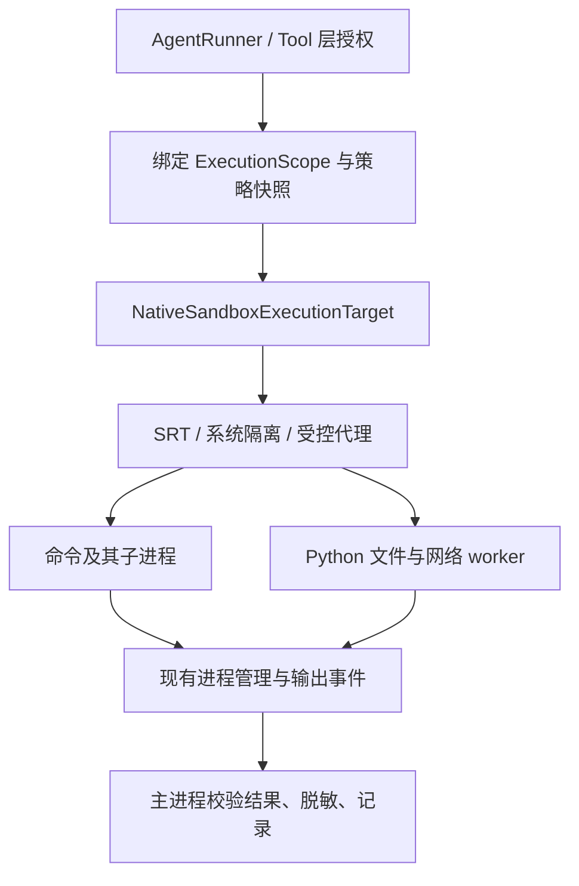

# 原生沙箱接入执行方案

> 状态：P0 实测进行中，发现硬链接和 macOS CLI 清理缺口；尚未通过 P0，bot 尚未接入操作系统沙箱。
> 实测记录：[native-sandbox-validation.md](../evaluations/native-sandbox-validation.md)。
> 日期：2026-09-22。基线：`84c5996`，并核对当前工作区源码。
> 目标平台：macOS、Linux。首版选择 SRT，保留现有 Tool 层授权，在工具实际访问文件、执行命令和联网时增加系统约束。

## 1. 首版交付与边界

首版交付一个可显式启用的 `sandbox.mode = "required"` 模式：

1. 所有模型触发的通用命令、文件读写、搜索和 URL 获取，都经受限执行路径。
2. 文件读取、写入、网络出口使用同一份调用级策略；秘密和控制数据有额外禁止规则。
3. 父 Agent、只读子 Agent、worktree 子 Agent 的权限分别绑定，不能互相污染。
4. 建立沙箱失败、缺少必需能力、配置无效时，工具不执行；不回退宿主执行。
5. 保留当前流式输出、进程轮询、交互输入、取消、超时、清理失败和配额语义。
6. macOS 与 Linux 分别通过真实隔离验证，提交安全、兼容和性能结果。

首版不提供 Windows、容器、microVM 后端，不承诺多租户隔离、独立内核、完整防泄漏或强 CPU/内存配额。原生沙箱不能防止授权工作区内的数据被破坏；现有 Git/worktree 和交付验证仍有独立作用。

整个 bot 不进入沙箱。模型调用、会话数据库、审批、日志与调度留在可信主进程。业务工具授权继续生效，不能用“已经有沙箱”替代用户/会话权限检查。

## 2. 已核对的现状

| 位置 | 当前行为 | 接入要求 |
|---|---|---|
| [execution/base.py](../../src/bot/execution/base.py) | `ProcessSpec` 有 argv/cwd/env/超时；`ExecutionTarget` 有受管进程接口，没有沙箱策略 | 增加内部调用作用域、能力报告和执行元数据；不暴露原始策略给模型 |
| [execution/local.py](../../src/bot/execution/local.py) | 直接启动本机进程；已有输出、取消、进程清理及配额 | 复用进程管理，拆出实际启动规格与逻辑命令；保护包装器及其后代 |
| [tools/builtins.py](../../src/bot/tools/builtins.py) | 文件工具直接读写 `Path`，`fetch_url` 在主进程使用 HTTPX | 文件、搜索、patch、fetch 下沉到受限 Python worker |
| [tools/subprocess_adapter.py](../../src/bot/tools/subprocess_adapter.py) | 专用 CLI 经 target 执行，但未传 session/run 标识 | 补齐调用作用域；不兼容沙箱的硬件操作明确拒绝 |
| [tools/base.py](../../src/bot/tools/base.py) | `resolve_path` 已检查工作区、符号链接、内部禁止路径 | 保留前置校验，worker 内再次校验，并将相同限制编译到 OS 策略 |
| [policy/engine.py](../../src/bot/policy/engine.py) | 命令和参数检查、ALLOW/ASK/DENY、审批复用 | 审批只授权业务调用，不隐含扩大 OS 权限 |
| [config/loader.py](../../src/bot/config/loader.py) | 默认将项目配置覆盖用户配置 | 沙箱与安全上限必须保留配置来源，项目配置不能扩大权限或关闭沙箱 |
| [cli/runtime.py](../../src/bot/cli/runtime.py) | 构建 `LocalExecutionTarget`，父子 runner 共享 target；Runtime 直接使用清理属性 | 改为统一工厂及受管执行接口，消除可变共享策略 |
| [subagents/pool.py](../../src/bot/subagents/pool.py) | 管理 Git worktree、patch、diff 的进程与 Agent 命令共用 target | 为可信管理操作建立独立受限作用域，不能开放给任意模型命令 |
| [core/agent.py](../../src/bot/core/agent.py) | 重复读取检查会直接读取目标文件计算版本 | 经受限文件接口获取版本，避免留下工具外的宿主读取入口 |

已有 `_safe_environment()` 是环境变量白名单，但保留真实 HOME/PATH，随后还合并 `spec.env`。原生模式需专门构建环境，不能只沿用该函数就宣称凭证隔离完成。

## 3. 技术决策

| 决策 | 首版选择 | 原因 |
|---|---|---|
| OS 运行时 | SRT CLI；macOS Seatbelt，Linux bubblewrap | 复用文件与网络实现，暂不自研两套后端 |
| 依赖 | 固定已验证的 Node、SRT 与系统依赖版本 | 不在工具执行时使用 `npx latest` 或自动下载；P0 才选定实际发布版本 |
| 执行粒度 | 每次命令/文件工具调用启动受限进程 | 便于绑定独立策略、取消和销毁；先测开销，再考虑常驻 |
| Python 文件工具 | 安装于可信目录的 worker，一次请求后退出 | 与任意项目代码分开，禁止从工作区加载 worker 实现 |
| IPC | 文件 worker 使用有界 JSON Lines；stderr 为诊断 | 不新增监听端口；不传 Python 对象/pickle，不支持任意函数调用 |
| 网络 | `deny` 或 `allowlist`，通过受控代理 | 不提供首版 `allow-all`；必须同时阻断直接联网 |
| 权限变化 | 调用启动后固定；配置变化在新 Run 生效 | 不依赖 SRT 动态配置更新，不改变运行中进程权限 |
| 不可用处理 | `required` 下拒绝执行 | 不自动回退 Local、Landlock 或较弱嵌套模式 |
| 资源控制 | 复用超时、输出和受管配额；报告缺少硬资源上限 | Linux cgroups 作为后续独立增强，不冒充已覆盖子进程总数 |

P0 若发现 CLI 无法保证 argv、流式输出或清理契约，可在同一适配层改用一个固定版本的 Node helper 调用 SRT library。必须先更新该决策并重跑 P0；不得以兼容为由移除隔离。当前上游 `main` 的行为只作为调研依据，不等于待锁定发布版已经具备全部能力。

## 4. 调用链与模块划分



建议新增模块；名称为实施约定，不表示文件已存在：

| 模块 | 职责 |
|---|---|
| `src/bot/sandbox/models.py` | `SandboxPolicy`、`SandboxCapabilities`、`ExecutionScope`、错误类型 |
| `src/bot/sandbox/policy.py` | 由可信配置、父策略、workspace、protected paths 生成不可变快照 |
| `src/bot/sandbox/srt.py` | 探测版本、编译显式配置、构建启动规格、维护调用资源 |
| `src/bot/sandbox/worker.py` | 固定操作枚举：read/search/apply_patch/fetch/file_version |
| `src/bot/sandbox/client.py` | 有界请求/响应校验、超时、协议错误与 ToolResult 映射 |
| `src/bot/execution/native.py` | 实现受管 `ExecutionTarget` 接口，组合现有进程管理 |
| `src/bot/execution/factory.py` | 显式选择 off/required 后端，供 CLI/Web/eval 共用 |

内部数据约定：

```text
ExecutionScope
  session_id, run_id, tool_call_id, workspace, policy_id

SandboxPolicy（不可变）
  read_roots, write_roots, deny_read, deny_write
  network_mode, allowed_domains
  environment_names, protected_paths, home_dir, temp_dir, cache_dir

SandboxCapabilities
  backend, backend_version, os_version, architecture
  file_read, file_write, network_filter, process_isolation, resource_limits
  每项为 enforced / unavailable / unverified，并保存探测证据

SandboxLaunch
  logical_argv, launcher_argv, cwd, environment
  scope, policy_id, resource_handles
```

- `ProcessSpec` 增加内部 scope 引用，或由绑定作用域的 target 包装器携带；不得从 Tool 参数反序列化任意 `SandboxPolicy`。本方案采用显式 scope 引用，由 `ToolContext` 注入。
- CLI、Web、父子 Agent 共用工厂。`Runtime.target` 改为描述受管生命周期的接口，包含 `has_live_processes`、清理恢复和 observer；保留现有关闭顺序。
- 多个调用可以共享进程注册表，不能共享可变的“当前 workspace/权限”。每个 process_id 绑定不可变 scope，poll/input/terminate/output 按 session/run 校验归属。
- 界面显示原始逻辑命令，内部另记实际 launcher，避免包装器 argv 改变重复调用识别和进程证据。
- 命令仍用原始 stdout/stderr 流，不把任意命令输出当 worker 协议解析。文件 worker 的 stdout 仅允许固定 schema；空响应、多终态、超长消息、错误 request_id 均为协议失败。
- 文件 worker 保留目前 patch 的精确匹配、原子替换和 metadata/progress 语义；主进程校验响应格式。worker 回报的文字不能成为新权限或宿主指令。

## 5. 文件、凭证与配置策略

### 5.1 工作区及受保护路径

- 沿用用户指定 workspace；不默认复制整个项目。每个 Run 创建独立的 home/tmp/cache，工作区文件保留现有持久化语义。
- `safe` 允许写当前工作区及任务私有临时目录；`read-only` 不允许写工作区，但允许明确列出的内部临时目录。Tool 层仍可能更严格。
- 读取范围为当前工作区、可信 worker/解释器/动态库及经过验证的必要系统文件，不继承 SRT 的广泛读取默认值。额外读取目录必须显式配置。
- 使用已解析的规范路径，处理 macOS `/tmp` 与 `/private/tmp`、符号链接、未创建路径及 Git worktree 的外部 gitdir；不要仅做字符串前缀判断。
- 硬禁止读取秘密：实际模型密钥来源文件、用户 SSH/云凭证等；以解析后的路径和文件策略落实，不能只匹配命令中的文件名。
- 状态数据库及其 WAL/SHM/journal、审批记录、会话日志、沙箱配置和控制 socket 不进入任务读写范围；运行时安装目录仅允许启动所需的读取，禁止写入。工作区内存在这些路径时，必须单独排除。
- 任务不能写 `.bot/config.toml`、主进程会执行的扩展/启动配置或其替代路径。项目代码可写，但下次由宿主执行前仍属于不可信输入。
- 不把 `.bot` 整棵树粗暴拒绝后又试图写其子 worktree；按实际控制路径和当前任务子目录生成互不冲突的规则。父任务排除整个受管 worktree 根目录，子任务仅授权自己的工作树，不通过枚举当前已有兄弟目录建立边界，避免遗漏随后创建的任务。其他 Run 临时目录不可访问。
- 首版普通任务默认只读 Git 元数据，保护配置、hooks 和外部 common gitdir；需要修改 Git 元数据的命令可能被拒绝。受管 worktree/patch 管理见第 7 节；不能为兼容 `git commit` 默认放开整个 `.git`。

若某后端不能落实必要的读取或保护路径规则，能力验证失败，`required` 模式不得启动。不能用应用层预检查替代缺失的 OS 边界并报告成功。

### 5.2 启动环境

原生模式使用单独的完整环境构建器：

- 使用可信解析出的绝对 Node/SRT/Python 路径；不要从工作区 PATH 查找同名启动器。
- 子进程 HOME、TMPDIR、缓存目录指向任务目录，PATH 只包含所需程序位置；调用者的额外 env 也需经过校验。
- 不继承模型 Key、云凭证、`SSH_AUTH_SOCK`、Docker socket、加载器注入变量、`NODE_OPTIONS`、`PYTHONPATH`、任意代理/启动脚本环境变量。
- worker 从工作区外的只读安装运行，Python 使用隔离启动方式；验证 `.pth`、site customization 和 cwd 模块覆盖不会加载项目代码。
- 清理继承的文件描述符；只保留必要的输入、输出和受控通信。策略文件不能位于任务可写目录。
- 不默认读取用户 shell rc 或 Git 全局配置。构建工具需要的缓存/证书等由明确规则提供，记录兼容成本。

### 5.3 配置来源和首版示例

以下是计划中的 bot 配置，不是现有可用配置，也不是 SRT 原生 JSON：

```toml
[sandbox]
mode = "required"                 # off | required
backend = "srt"
read_roots = []                    # 工作区和平台必需运行库由可信 resolver 添加
write_roots = []                   # 工作区权限由 permissions.mode 约束

[sandbox.network]
mode = "allowlist"                # deny | allowlist
allowed_domains = ["pypi.org", "files.pythonhosted.org"]
```

- 安全上限来自用户级可信配置或用户显式指定并信任的配置文件；保留来源信息。项目配置只能缩小权限，不能设置 `off`、选择任意启动器、添加根目录或放宽 `permissions` 所决定的安全上限。
- 启动器路径与依赖锁定由安装/运行时清单管理，不允许模型通过 env、项目配置或 Tool 参数替换。
- `permissions.network = "deny"` 与沙箱配置取交集，必定断网；`ask/allow` 只决定业务层是否需要确认，实际出口仍受域名范围约束。
- `permissions.auto_approve` 和已有命令审批规则不关闭沙箱；`full-access` 在 required 模式下也不能突破用户确定的沙箱上限。界面应解释此行为。
- 首版没有运行中扩权或新授权工具。域名/目录不足时返回所需资源，用户修改可信配置后开启新 Run；不自动重放已部分执行的命令。以后若新增一次性扩权，需要单独绑定调用与策略差异。
- 兼容期已有配置缺省为 `off`，启动和事件明确记录未隔离；新使用指南展示 `required`。不能把 off 的成功回归计为沙箱验证通过。

## 6. 网络与拒绝语义

`deny` 禁止工具进程直接联网；`allowlist` 必须通过受控代理，并阻止原始连接、忽略代理变量、IPv4/IPv6 替代路径等绕过方式。首版不使用宽泛域名通配符。

公网 fetch/依赖下载场景还需要验证：代理解析后的目标不能是本机、内网、链路本地或云元数据地址；重定向和重新解析不得绕过限制。不能仅检查初始 URL 的主机名。P0 确认锁定 SRT 版本的实际能力；若不足，先交付断网模式，allowlist 模式保持禁用，补充受控出口实现并验证后再开放。

`FetchUrlTool` 的请求放到 worker，显式使用受控代理。逐跳检查重定向，保留超时及输出截断语义，并增加响应读取的总字节上限，避免当前“完整读取后再截断输出”的内存开销；安装包客户端也应经过相同出口。允许访问某域名不等于阻止向该服务上传数据，首版不宣称内容级 DLP。

错误映射：

| 错误码 | 含义 | 处理 |
|---|---|---|
| `SANDBOX_UNAVAILABLE` | 后端缺失、探测失败或必需能力缺失 | 未启动目标命令，不回退 |
| `SANDBOX_CONFIG_INVALID` | 无效策略、无法表达必要限制 | 未启动目标命令，说明配置问题 |
| `SANDBOX_LAUNCH_FAILED` | 包装器/代理启动失败 | 记录启动阶段；若无法确认目标是否运行，则标记 unknown 并清理 |
| `POLICY_DENIED` | 经可信后端证据确认的拒绝 | 给出受限资源；不自动重试或自动扩权 |
| `COMMAND_FAILED` | 目标程序非零退出 | 保留原始退出码及有界输出 |
| `TOOL_PROTOCOL_ERROR` | worker 返回无效/不完整协议 | 不伪造成功，终止并回收 |
| `CLEANUP_FAILED` | 后代、代理或任务资源未确认回收 | 维持现有占用与阻塞语义 |

不能把所有 `PermissionError` 或包含 “denied” 的 stderr 都断言为沙箱拒绝。区分结构化后端事实、策略日志和不可信程序输出；证据不足时保留普通失败与诊断。`executed=false` 只用于确认未启动目标的情况，不能用于运行中拒绝。

## 7. 完整覆盖与可信管理操作

在工具注册表增加固定的执行分类，并在 required 模式检查完整性：

| 分类 | 示例 | 规则 |
|---|---|---|
| `confined` | run_command/run_shell、read/search/patch/fetch、外部 CLI | 必须通过受限 target 或 worker |
| `brokered` | 会话引用、记忆/Skill 读取、计划持久化、进程控制 | 主进程只执行枚举业务动作，检查会话归属、路径与输出；不能变成任意文件/命令接口 |
| `pure` | 纯参数/结果计算 | 不访问宿主资源 |

未声明或未审计的自定义工具在 required 模式拒绝注册。分类由实现确定，不接受模型或项目配置自报“可信”。Skill 脚本若作为命令执行，仍是 confined；仅加载用户选定 Skill 资源不能顺带授予整个主目录访问。

需要专门修改的外围路径：

1. `AgentRunner` 的文件版本检查经受限 `file_version` 操作完成；审计其他按模型输入读取文件的辅助代码。
2. 只读子 Agent 将父策略收紧；worktree 子 Agent 仅能写自己的工作树和临时目录，必要 Git 元数据按用途单独处理。父子进程标识必须在 `SubprocessCliTool` 等路径完整传递。
3. Git worktree 创建/删除、diff 和 patch 应用使用内部专用管理作用域，允许必要 Git 元数据与目标工作树写入，但仍经过沙箱。只接受固定 argv 模板和已校验 ref/path，禁止任意 command 参数。
4. Git 管理路径禁止 hooks、fsmonitor、外部 diff、未审计过滤器和凭证 helper 执行；审计仓库本地配置与 attributes。失败时拒绝该管理操作，不调用未受限宿主 Git 兜底。
5. `ksys/tuner` 若需要宿主设备、内核诊断或额外权限，required 模式先报告不支持该能力。不能自动 sudo、关闭沙箱，或将手工宿主命令当作沙箱成功结果。
6. 评测脚本显式选择后端，不能继续各自构建 Local 并声称测到了 native；doctor 的纯环境发现可以留在主进程，实际隔离探针必须经过原生 target。

首版同一用户仍共享宿主内核，不把任务目录命名和进程登记当作多租户隔离证明。MCP、GUI 自动化等后续入口接入时必须重新登记覆盖范围。

## 8. 进程、观测与恢复

- 一个受管调用同时拥有 launcher、目标命令后代、代理及临时策略资源。包装器退出不等于目标已全部退出，也不等于代理已回收。
- 继续复用 `ProcessScope` 的身份检查、配额、`cleanup_status` 和输出完整性；P0 验证 SRT 实际进程树后再决定所需扩展，不能仅 kill 最外层 PID。
- 隔离任务的后台进程可能脱离原 session。macOS 若无法可靠确认清理，返回 unknown/incomplete 并阻止继续；Linux 后续可增加 cgroup 级回收。不得把 best-effort 扫描宣传为完整生命周期隔离。
- 取消、超时和 runtime 关闭使用同一幂等清理路径。策略目录、代理 socket、锁等在确认进程结束后回收；崩溃残留依赖 owner、启动时间等检查，不按 PID 或可写目录内容盲目接管。
- `progress_scope/cleanup_scope` 包含后端和必要版本信息，恢复时重新验证；旧 local 清理记录不能误当 native 活进程，用户修改配置也不能给旧进程补授权限。
- 为事件增加 scope、policy_id、backend/version、实际能力、失败阶段与 cleanup_status；不记录密钥值和完整环境。复用现有脱敏、持久化及 CLI/Web 展示链路。
- 运行状态来自父进程验证；工具输出不能伪造审批、能力探测或清理成功。首版不保存新的可复用沙箱扩权规则。

## 9. 六个实施阶段与提交边界

以下工时为一名熟悉项目的工程师的初步估算，不是实测交付承诺；P0 后重估。阶段之间顺序推进，各提交均保留 off 模式可用。

| 阶段 | 具体交付 | 完成门槛 | 估算 |
|---|---|---|---|
| P0：真实后端验证 | 独立探针、Node/SRT 锁定清单、两平台能力表、进程树和网络证据 | 核心读写拒绝、argv 保真、子进程、断网、取消成立；明确 allowlist 能否开放 | 1–2 人日 |
| P1：策略与配置 | 模型、配置来源/上限、resolver、factory、doctor 能力显示 | 无效配置拒绝；项目/子 Agent 不能扩权；策略并发互不影响 | 1–2 人日 |
| P2：命令接入 | Native target，复用流式/受管 API，补齐 scope、清理和错误映射 | run_command/run_shell/CLI adapter 全走原生路径；既有清理与交互语义通过 | 2–3 人日 |
| P3：文件和网络工具 | worker/client，read/search/patch/fetch/file_version 迁移 | 项目外访问通过所有入口均被拒绝；原有结果和 patch 行为兼容 | 2–3 人日 |
| P4：外围入口和观测 | 子 Agent/worktree 管理、工具分类、可信 broker 审计、CLI/Web/eval 接线 | required 无未分类入口；状态/配置/跨会话边界通过；无宿主兜底 | 2–3 人日 |
| P5：验收与发布 | 两平台攻击面回归、日常任务对照、性能结果、指南与状态文档 | 第 10 节矩阵通过，记录全部限制，显式发布 required 模式 | 1–2 人日 |

合计初估 9–15 人日；不包含新出口代理、跨平台环境采购或依赖上游修复的等待。若只完成 P2，只能标记“命令执行沙箱原型”，不能发布为完整工具沙箱。

每阶段使用准确的独立 commit，检查暂存差异，排除用户已有改动。依赖锁、实现、相应测试和必要文档一起提交；不 push 或创建 PR。

## 10. 验收矩阵

测试只使用自建临时文件、假密钥、受控网络服务和有限子进程，不读取真实凭证，不对真实用户文件执行破坏动作。

| 编号 | 场景 | 必须观察到的结果 |
|---|---|---|
| S01 | 项目内正常 read/search/patch、Python 测试 | 成功，结果格式与原工具一致 |
| S02 | 项目外写入，通过文件工具、Shell、Python 脚本、孙进程分别尝试 | 全部拒绝，外部哨兵内容不变 |
| S03 | 读取假 SSH/云凭证、项目 `.env`、状态库/策略文件 | 全部拒绝，输出不含哨兵；主进程仍能正常访问自己的控制数据 |
| S04 | 符号链接/链接替换、rename、hard link、真实路径别名 | 必需拒绝规则不被绕过；不满足时该平台/策略不能标记支持 |
| S05 | 原始 TCP、IPv4/IPv6、UDP、忽略代理变量、非授权 Unix socket | 无策略外通道；合法代理请求按模式成功或拒绝 |
| S06 | 非白名单域名、跨域重定向、域名解析到私网/链路本地 | allowlist 不被绕过；证据不足则该网络模式不发布 |
| S07 | 删除/破坏测试后端配置、缺依赖、runner 启动失败 | 无普通宿主执行，无目标写入；错误阶段明确 |
| S08 | 同时运行父任务、只读子任务、两个 worktree 子任务 | 无读写根/网络串用；跨会话 process_id 操作被拒绝 |
| S09 | 命令审批复用、auto_approve、项目配置要求 off/full-access | 不能放宽系统沙箱上限 |
| S10 | HOME/PATH/加载器变量、恶意同名 worker/launcher、继承 FD | 不加载工作区伪造程序，不带出主进程秘密或控制通道 |
| S11 | 取消与 spawn 竞态、后台孙进程、根进程先退出、关闭流 | 清理成功或准确标记 incomplete/unknown，未清理时保留配额 |
| S12 | 交互输入、大输出、UTF-8 分片、poll/read_output | 不丢协议、不串流；保持截断及 output_complete 语义 |
| S13 | worker 伪造/截断/超长消息、命令伪造沙箱日志 | 不伪造审批、能力或成功；响应按协议失败处理 |
| S14 | Git 管理、只读 Skill 资源、记忆/引用 broker | 固定业务动作可用，不能转成任意宿主读写/命令执行 |
| S15 | 主进程崩溃、重启、配置/版本变化、残留进程与资源 | 不误认 PID，不继承旧扩权，不把清理不明当完成 |

自动化分三层：

1. 单元测试：配置来源、策略交集、argv 编码、scope 归属、协议边界、错误映射。不用仅断言“调用了 SRT”的 mock 代替隔离证据。
2. 原生集成测试：新增 `tests/integration/test_native_sandbox.py`，分别运行在 macOS 和具备所需能力的 Linux 主机。开发环境缺后端可注明 skip；发布验收指定平台缺能力必须失败，不能用 skip 报通过。Linux ARM 若未验证则单列为未支持/未验证。
3. 业务回归：命令、文件、runtime cleanup、CLI、Web、子 Agent/worktree；只读和 required/off 分开记录。遵循现有测试接口，先跑受影响测试，再做一次全量回归。

实施阶段的命令示例（新增测试文件落地后才有效）：

```bash
uv run pytest tests/unit/test_execution_tools_policy.py tests/unit/test_process_cleanup.py tests/unit/test_runtime_cleanup.py
uv run pytest tests/integration/test_native_sandbox.py
uv run pytest tests/integration/test_subagent_integration.py tests/integration/test_subagent_worktree.py tests/integration/test_cli_e2e.py tests/integration/test_web_workbench.py
uv run pytest
uv run ruff check src/bot tests
git diff --check
```

若全仓检查存在基线问题，记录与本任务的关系，不为通过检查混入无关修改。对实际修改的 Python 文件执行格式检查；Web 展示有修改时补对应状态与浏览器回归。

## 11. 性能与兼容验收

新增可重复的基准脚本，固定机器、输入、缓存状态、Node/SRT 版本。分别测 off/required；网络使用受控端点，不把公网波动算成沙箱开销。

- 冷启动单独报告；预热后每类至少 30 次，记录 p50/p95、峰值 RSS、总 CPU 时间和残留资源。
- 样本包括短命令、读取小文件、搜索千文件项目、patch、Python 测试、依赖安装、长命令交互与受控 HTTP 获取。
- 选 10 个代表性日常任务，不必调用真实模型即可验证主要工具兼容；若做模型端到端对照，再单列 token、重试次数和权限失败。
- 首轮工程目标：预热后的短调用额外 p95 不超过 500 ms；持续 10 秒以上计算任务中位耗时增幅不超过 10%；选定日常任务在相同授权范围内全部完成。数值是待 P0 校准的验收目标，不是已测性能。
- 超标时先分析启动器/代理重复初始化、worker 导入和配置编译。优化不得放宽读写/网络策略；需要常驻时另写作用域、并发与清理设计。
- 任何必要安全项失败都阻止对应模式发布；性能目标调整需在评测中解释，不能以静默宿主回退获得好成绩。

输出拟放入 `docs/evaluations/native-sandbox-validation.md` 和 `docs/data/native-sandbox-validation.json`，包含平台、版本、支持范围、失败/跳过、原始日志索引以及已知限制。

## 12. 发布、回退与下一步

发布前更新使用指南、doctor、执行架构与实现状态，清楚区分 off、required、断网和经过验证的 allowlist。安装脚本锁定版本，升级依赖后重跑核心边界测试；启动时不下载依赖。

回退必须由可信用户显式选择 off 并开启新 Run；先回收原有执行资源。required 的失败本身不会触发回退。回退后的事件和界面标明未隔离，历史审计保持原事实。

实际开工从 P0 开始：确认两平台可用测试环境，选定发布版，验证读取白名单、网络出口、argv 与取消语义，再据证据确定首版可开放的能力。P0 不通过时保留原型和失败报告，不继续包装成完整沙箱功能。

## 参考依据

- [SRT README](https://github.com/anthropics/sandbox-runtime)：CLI/library、平台后端、文件和代理网络配置；研究预览状态。调研于 2026-09-22。
- [SRT CLI 实现](https://github.com/anthropics/sandbox-runtime/blob/main/src/cli.ts)：命令参数处理、显式配置、进程退出与信号链路；实施以 P0 锁定版本为准。
- [bubblewrap](https://github.com/containers/bubblewrap)：隔离由参数组合确定；暴露宿主 socket 等接口可能扩大权限。
- [Landlock 内核文档](https://docs.kernel.org/userspace-api/landlock.html)：权限收紧、ABI 能力与限制，不能无条件作为等价回退。
- [cgroups v2](https://docs.kernel.org/admin-guide/cgroup-v2.html)：资源限制与进程组织，后续增强依据。

2026-09-23 已安装锁定 Node/SRT 并执行两平台独立探针，业务运行逻辑尚未修改。
P0 的失败证据与后续门槛见实测记录，六阶段范围保持不变。
